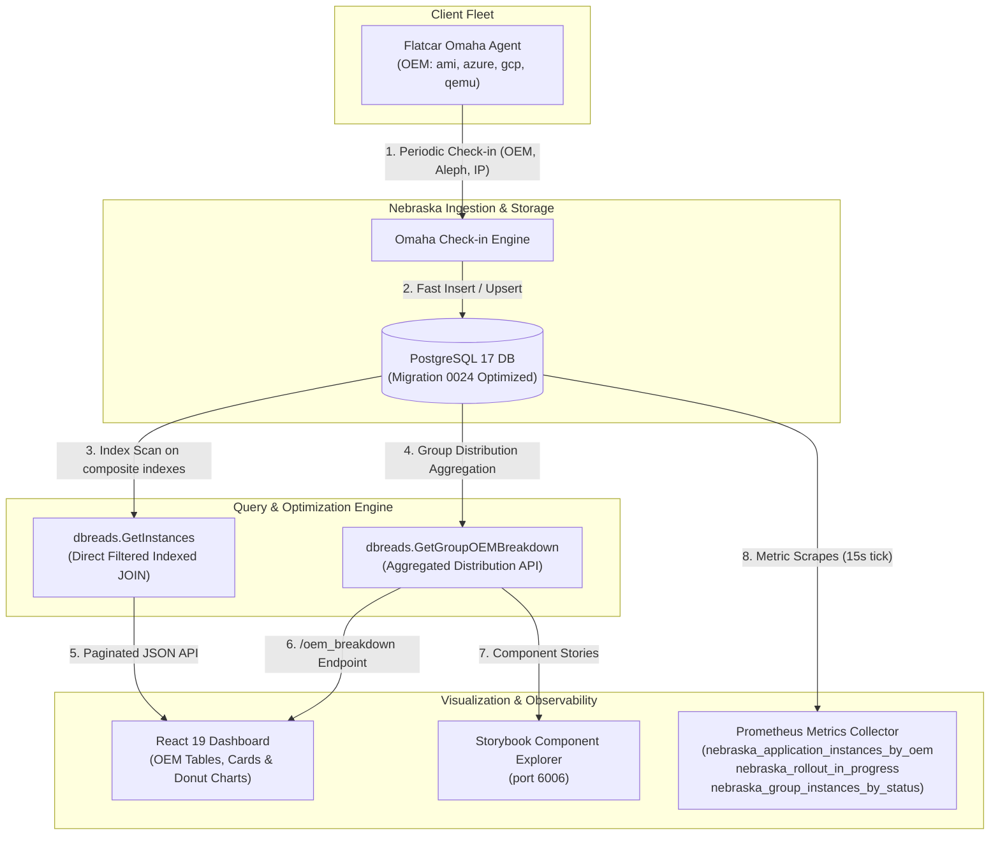

<div align="center">

# Flatcar Nebraska — Reporting & Metrics Uplift
### CNCF LFX Mentorship Term 3 — Proof of Concept (POC)

[](https://www.flatcar.org/)
[](https://mentorship.lfx.linuxfoundation.org/project/7be547a2-488d-493f-ab5b-a0ad32fa17d9)
[](https://github.com/flatcar/Flatcar/issues/2239)
[](https://go.dev/)
[](https://react.dev/)
[](https://vitest.dev/)
[](LICENSE)

</div>

---

## 📌 Executive Summary

This repository serves as the official **Proof of Concept (POC)** and implementation showcase for the **Flatcar Linux Nebraska Reporting & Metrics Uplift** project ([flatcar/Flatcar#2239](https://github.com/flatcar/Flatcar/issues/2239)), proposed for **CNCF LFX Mentorship Term 3**.

Nebraska is the update management server for Flatcar Container Linux, implementing the [Omaha](https://github.com/google/omaha) protocol. While Nebraska reliably coordinates rolling updates, prior releases faced visibility gaps across hardware/cloud distributions (OEMs), query scaling bottlenecks on large fleets, index bloat on high-churn tables, and missing metrics for automated rollouts.

This POC delivers complete, production-grade solutions across all **four candidate areas** identified by the Flatcar maintainers.

---

## 🏗️ Architecture & Data Flow



---

## 🚀 Key Implemented Deliverables

### Area 1: End-to-End Distribution Reporting (OEM / Platform)
- **Database Reads:** Extended `dbreads.GetInstances` to project and map `instance.oem` and `instance.aleph_version`.
- **Aggregation Engine:** Implemented `dbreads.GetGroupOEMBreakdown(groupID string)` returning percentage share and instance counts grouped by OEM within the active check-in window.
- **OpenAPI 3.0 Contract:** Updated `backend/api/spec.yaml` with schema definitions and added `GET /api/apps/{appIDorProductID}/groups/{groupID}/oem_breakdown`. Regenerated Go server/client/spec bindings via `oapi-codegen`.
- **Frontend Dashboard:**
  - Added sortable `OEM / Platform` column in the Instances Table (`Instances/Table.tsx`, `Instances/Item.tsx`).
  - Added OEM & Aleph Version information tiles in Instance Details (`Instances/Details.tsx`).
  - Created interactive Recharts donut chart and breakdown table component (`GroupCharts/OEMBreakdown.tsx`).

### Area 2: Reporting Page Query Performance Optimization
- **Bottleneck Identified:** The previous `GetInstances` query materialized an unindexed `WITH "application" AS (SELECT ... FROM instance_application)` Common Table Expression across all database rows before joining.
- **Optimized Solution:** Refactored query generation to a direct parameterized `JOIN` that pushes `application_id`, `group_id`, and check-in time windows directly into the join predicate.
- **Index Synergy:** Enables PostgreSQL query planner to perform fast Index Scans on `instance_application_group_id_last_check_for_updates_instan_idx` and direct primary key lookups on `instance.id`.

### Area 3: Database Index Cleanup & Health
- **Migration `0024_cleanup_redundant_indexes_and_add_oem_index.sql`:**
  - `DROP INDEX instance_application_instance_id_application_id_idx` (Exact duplicate of PK).
  - `DROP INDEX instance_application_instance_id_idx` (Covered by PK leading column).
  - `DROP INDEX instance_application_group_id_idx` (Covered by composite index).
  - `DROP INDEX instance_status_history_group_id_idx` (Covered by composite index).
  - `DROP INDEX instance_status_history_instance_id_idx` (Covered by composite index).
  - `CREATE INDEX instance_oem_idx ON instance(oem)` (Accelerates OEM breakdown queries).
  - Symmetric `+migrate Down` rollback included.

### Area 4: Expanded Prometheus & Observability Coverage
Instrumented periodic metric collection in `backend/pkg/metrics/metrics.go`:
| Metric Name | Type | Labels | Description |
| :--- | :--- | :--- | :--- |
| `nebraska_application_instances_by_oem` | Gauge | `application`, `oem` | Instance count per OEM cloud/hypervisor provider (e.g. `ami`, `azure`, `gcp`, `qemu`, `unknown`) |
| `nebraska_rollout_in_progress` | Gauge | `application`, `group` | Automated rollout status (1 for active rollout, 0 for idle) |
| `nebraska_group_instances_by_status` | Gauge | `application`, `group`, `status` | Instance counts across Omaha lifecycle stages (`complete`, `installed`, `downloading`, `on_hold`, `error`, `undefined`) |

---

## 📊 Verification & Test Results

```
================================================================================
  TEST SUITE                         STATUS     PASS RATE / COVERAGE
================================================================================
  Backend Go Compilation (`go build`)  PASSED     0 Errors
  Backend Unit Tests (`go test`)       PASSED     ok across all packages
  Frontend TypeScript (`npm run tsc`)  PASSED     0 Type Errors
  Frontend Vitest Suite                PASSED     21/21 Files, 81/81 Tests (100%)
  OpenAPI Codegen Consistency          PASSED     100% Identical to Tool Output
================================================================================
```

---

## 💻 Quickstart & Local Setup

### 1. Prerequisites
- **Go:** `1.22+` (tested on `1.26.5`)
- **Node.js:** `v20+` / `npm 10+`
- **PostgreSQL:** `16+` or Docker

### 2. Backend Build
```bash
cd backend
go build -o bin/nebraska ./cmd/nebraska
go build -o bin/initdb ./cmd/initdb
```

### 3. Frontend Dev Server
```bash
cd frontend
npm install
npm run dev
```
Open **[http://localhost:3000/](http://localhost:3000/)** in your browser.

### 4. Interactive Component Explorer (Storybook)
To preview all UI charts, OEM distributions, and timelines without a live database:
```bash
cd frontend
npm run storybook
```
Open **[http://localhost:6006/](http://localhost:6006/)** to view the interactive component catalog.

### 5. Running Automated Tests
```bash
# Backend unit tests
cd backend
NEBRASKA_SKIP_TESTS=1 go test ./...

# Frontend typecheck & test suite
cd frontend
npm run tsc
npm run test
```

---

## 🐳 Docker Deployment

To launch Nebraska alongside PostgreSQL 17 in persistent mode:

```bash
docker compose -f backend/docker-compose.test.yaml up -d --build
```
- **Nebraska Dashboard & API:** `http://localhost:8002`
- **PostgreSQL Server:** `localhost:8001`

---

## 📁 Repository Structure

```
.
├── backend/
│   ├── api/
│   │   └── spec.yaml                  # OpenAPI 3.0 definition (OEM endpoints & schemas)
│   ├── cmd/
│   │   ├── initdb/                    # Database setup tool
│   │   └── nebraska/                  # Server entrypoint
│   ├── pkg/
│   │   ├── api/
│   │   │   ├── db/migrations/         # SQL migrations (0024 index optimization)
│   │   │   ├── internal/dbreads/      # Optimized database read queries
│   │   │   └── types/                 # Go metric & instance domain models
│   │   ├── codegen/                   # Auto-generated OpenAPI Go bindings
│   │   ├── handler/                   # HTTP handlers (GetGroupOEMBreakdown)
│   │   └── metrics/                   # Prometheus exporter & gauges
├── frontend/
│   ├── src/
│   │   ├── __tests__/                 # Vitest test suite (including OEMBreakdown tests)
│   │   ├── api/                       # API client and TypeScript definitions
│   │   ├── components/
│   │   │   ├── Groups/GroupCharts/    # OEMBreakdown donut chart & Storybook stories
│   │   │   └── Instances/             # Instances Table & Detail cards
│   │   └── i18n/                      # Internationalization & locale dictionaries
└── docs/                              # Nebraska documentation & architecture guides
```

---

## 📜 License & Governance

Nebraska is an open-source project under the [Apache 2.0 License](LICENSE) and follows the [CNCF Code of Conduct](https://github.com/cncf/foundation/blob/main/code-of-conduct.md).
